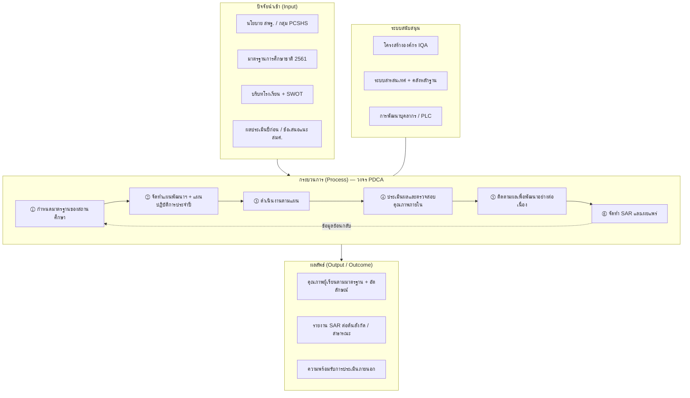
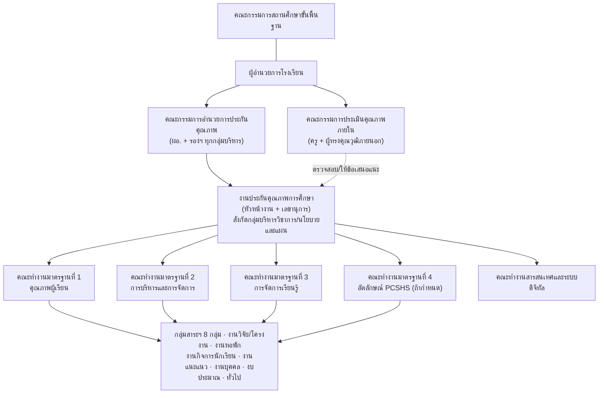
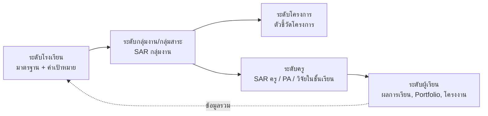
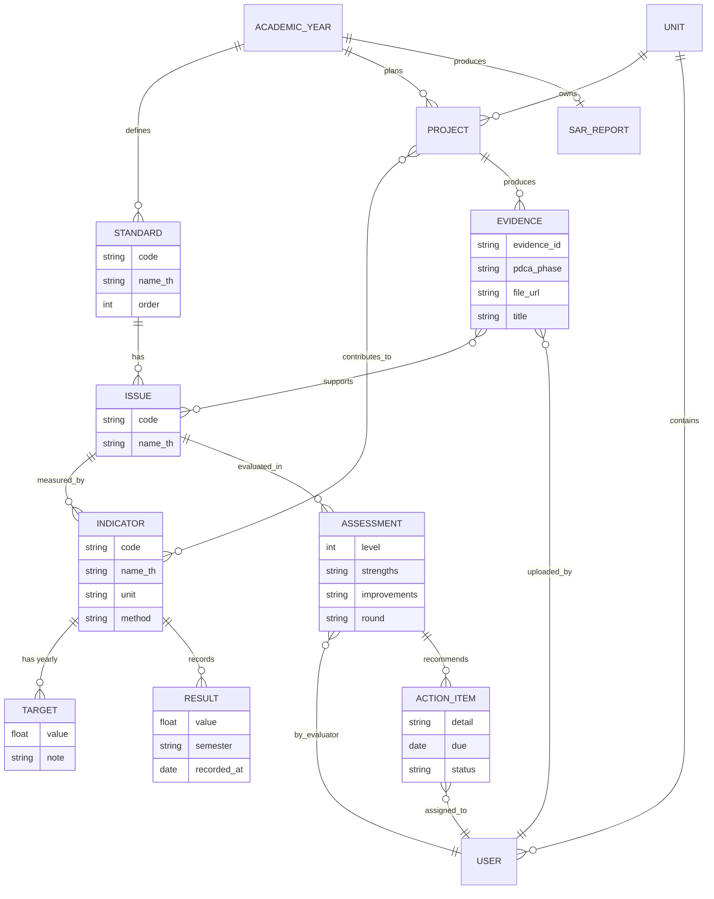

# การออกแบบโครงสร้างระบบประกันคุณภาพภายในสถานศึกษา
## โรงเรียนวิทยาศาสตร์จุฬาภรณราชวิทยาลัย เชียงราย (PCSHS Chiang Rai)

> ฉบับร่างเพื่อการพิจารณา (Draft v0.1) — ใช้เป็นกรอบตั้งต้นให้คณะกรรมการประกันคุณภาพของโรงเรียนปรับแก้
> รายการที่ต้องตรวจสอบกับเอกสารทางการ/มติของโรงเรียนอยู่ในหัวข้อที่ 9

---

## สารบัญ
1. หลักการและกรอบอ้างอิง
2. ภาพรวมโครงสร้างระบบ (System Overview)
3. โครงสร้างองค์กรและบทบาทหน้าที่
4. มาตรฐานการศึกษาของสถานศึกษาและประเด็นพิจารณา
5. กระบวนการประกันคุณภาพภายใน (6 ขั้นตอน + วงจร PDCA)
6. ปฏิทินการดำเนินงานรายปี
7. ระบบสารสนเทศและหลักฐานเชิงประจักษ์
8. สถาปัตยกรรมระบบดิจิทัล (pcshscr-iqa)
9. สิ่งที่ต้องยืนยัน/ตัดสินใจต่อ

---

## 1. หลักการและกรอบอ้างอิง

| กรอบ | สาระสำคัญที่ใช้ในการออกแบบ |
|---|---|
| พ.ร.บ.การศึกษาแห่งชาติ พ.ศ. 2542 และที่แก้ไขเพิ่มเติม (หมวด 6) | สถานศึกษาต้องจัดให้มีระบบประกันคุณภาพภายใน และถือเป็นส่วนหนึ่งของการบริหารที่ต้องดำเนินการอย่างต่อเนื่อง |
| กฎกระทรวงการประกันคุณภาพการศึกษา พ.ศ. 2561 | ขั้นตอนของระบบประกันคุณภาพภายใน และการจัดทำรายงานผลการประเมินตนเอง (SAR) เสนอต้นสังกัดและเผยแพร่ต่อสาธารณชน |
| ประกาศกระทรวงศึกษาธิการ เรื่อง มาตรฐานการศึกษาระดับการศึกษาขั้นพื้นฐาน พ.ศ. 2561 | มาตรฐาน 3 ด้าน: คุณภาพผู้เรียน / กระบวนการบริหารและการจัดการ / กระบวนการจัดการเรียนการสอนที่เน้นผู้เรียนเป็นสำคัญ |
| แนวทางของ สพฐ. และกลุ่มโรงเรียนวิทยาศาสตร์จุฬาภรณราชวิทยาลัย | หลักสูตรเน้นวิทยาศาสตร์ คณิตศาสตร์ เทคโนโลยี และการวิจัย; ระบบโรงเรียนประจำ |
| การประเมินคุณภาพภายนอก (สมศ.) | ใช้ SAR และหลักฐานเชิงประจักษ์ของโรงเรียนเป็นฐานการประเมิน |

**หลักคิดในการออกแบบ**
1. **IQA คือการบริหาร ไม่ใช่งานเอกสาร** — ฝังอยู่ในงานประจำของทุกกลุ่มงาน (Quality is everyone's job)
2. **ใช้วงจร PDCA ทุกระดับ** — ระดับโรงเรียน / กลุ่มงาน / โครงการ / ห้องเรียน
3. **หลักฐานเกิดจากการทำงานจริง** — เก็บครั้งเดียว ใช้ได้หลายรายงาน (SAR, สมศ., รายงานต้นสังกัด, ประเมินครู)
4. **สะท้อนอัตลักษณ์ PCSHS** — วิทยาศาสตร์ การวิจัย นวัตกรรม ความเป็นผู้นำ และการอยู่ร่วมกันในระบบโรงเรียนประจำ
5. **มีส่วนร่วมจากทุกภาคส่วน** — คณะกรรมการสถานศึกษา ผู้ปกครอง นักเรียน ศิษย์เก่า และชุมชน

---

## 2. ภาพรวมโครงสร้างระบบ



---

## 3. โครงสร้างองค์กรและบทบาทหน้าที่

### 3.1 แผนภูมิโครงสร้าง



> **หลักการแยกบทบาท:** คณะกรรมการประเมินคุณภาพภายในขึ้นตรงต่อผู้อำนวยการ และแยกจากคณะทำงานที่รับผิดชอบดำเนินงาน เพื่อให้การประเมินเป็นอิสระ

### 3.2 บทบาทหน้าที่

| หน่วย | หน้าที่หลัก | ผลผลิต |
|---|---|---|
| คณะกรรมการสถานศึกษาฯ | ให้ความเห็นชอบมาตรฐาน ค่าเป้าหมาย แผนพัฒนา และ SAR | มติเห็นชอบ |
| ผู้อำนวยการ | ผู้รับผิดชอบสูงสุด กำหนดนโยบายคุณภาพ ลงนามประกาศ | ประกาศมาตรฐาน/ค่าเป้าหมาย, คำสั่งแต่งตั้ง |
| คณะกรรมการอำนวยการฯ | กำกับทิศทาง จัดสรรทรัพยากร ทบทวนผลรายภาคเรียน | รายงานการประชุมทบทวน (Management Review) |
| งานประกันคุณภาพฯ | ประสานทั้งระบบ จัดปฏิทิน ออกแบบเครื่องมือ รวบรวมและเขียน SAR | คู่มือ IQA, เครื่องมือ, ร่าง SAR |
| คณะทำงานรายมาตรฐาน | กำหนดตัวชี้วัด เก็บข้อมูล วิเคราะห์ เขียนผลรายมาตรฐาน | รายงานรายมาตรฐาน + หลักฐาน |
| กลุ่มสาระฯ / งานต่าง ๆ | ดำเนินโครงการ/กิจกรรม เก็บหลักฐาน รายงานผลโครงการ | รายงานโครงการ, SAR ระดับกลุ่มงาน |
| ครูรายบุคคล | จัดการเรียนรู้ วิจัยในชั้นเรียน บันทึกผลผู้เรียน | แผนการสอน, บันทึกหลังสอน, ID Plan/PA |
| คณะกรรมการประเมินภายใน | ประเมินตามมาตรฐาน ตัดสินระดับคุณภาพ ให้ข้อเสนอแนะ | รายงานผลการประเมินภายใน |
| คณะทำงานสารสนเทศ | ดูแลระบบข้อมูล คลังหลักฐาน แดชบอร์ด | ระบบ pcshscr-iqa |

---

## 4. มาตรฐานการศึกษาของสถานศึกษาและประเด็นพิจารณา

ใช้มาตรฐานการศึกษาขั้นพื้นฐาน 2561 เป็นแกน และเพิ่ม **ประเด็นเฉพาะ PCSHS** ซึ่งโรงเรียนเลือกได้ 2 แบบ:
- **แบบ A** — สอดแทรกอัตลักษณ์ไว้ในประเด็นพิจารณาของมาตรฐาน 1–3 (เอกสารกระชับ)
- **แบบ B** — เพิ่ม "มาตรฐานที่ 4 อัตลักษณ์/เอกลักษณ์ของสถานศึกษา" แยกต่างหาก (เห็นจุดเด่นชัด)

### มาตรฐานที่ 1 คุณภาพของผู้เรียน

| ประเด็นพิจารณา | ตัวอย่างตัวชี้วัดเฉพาะ PCSHS เชียงราย (ร่าง) | แหล่งข้อมูล |
|---|---|---|
| **1.1 ผลสัมฤทธิ์ทางวิชาการ** | | |
| 1) การอ่าน เขียน สื่อสาร และคิดคำนวณ | ร้อยละผู้เรียนผ่านเกณฑ์การสื่อสารภาษาไทย/อังกฤษ; ผลสอบมาตรฐานภาษาอังกฤษ (CEFR) | ผลสอบ, แบบประเมิน |
| 2) การคิดวิเคราะห์ คิดอย่างมีวิจารณญาณ อภิปราย แก้ปัญหา | ผลประเมินทักษะการคิดในรายวิชาวิทยาศาสตร์/คณิตฯ | รูบริก, ผลงาน |
| 3) การสร้างนวัตกรรม | ร้อยละผู้เรียนมีโครงงาน/นวัตกรรมที่ผ่านการประเมิน; จำนวนผลงานเผยแพร่/ประกวด | ฐานข้อมูลโครงงาน |
| 4) การใช้เทคโนโลยีสารสนเทศและการสื่อสาร | ทักษะ coding / data literacy | ผลงาน, ใบรับรอง |
| 5) ผลสัมฤทธิ์ตามหลักสูตรสถานศึกษา | ร้อยละผู้เรียนมีเกรดเฉลี่ยตามเกณฑ์ในรายวิชาวิทย์–คณิต | ระบบทะเบียน |
| 6) ความรู้ ทักษะพื้นฐาน และเจตคติต่องานอาชีพ | ร้อยละผู้สำเร็จการศึกษาศึกษาต่อสาย STEM | ข้อมูลศิษย์เก่า/แนะแนว |
| **1.2 คุณลักษณะที่พึงประสงค์** | | |
| 1) คุณลักษณะและค่านิยมที่ดีตามที่สถานศึกษากำหนด | ผลประเมินคุณลักษณะอันพึงประสงค์ + จิตวิทยาศาสตร์ | แบบประเมิน |
| 2) ความภูมิใจในท้องถิ่นและความเป็นไทย | การมีส่วนร่วมกิจกรรมวัฒนธรรมล้านนา/ท้องถิ่นเชียงราย | บันทึกกิจกรรม |
| 3) การยอมรับความแตกต่างและหลากหลาย | ผลการอยู่ร่วมกันในหอพัก ความหลากหลายของผู้เรียน | งานหอพัก, แบบสำรวจ |
| 4) สุขภาวะทางร่างกายและจิตสังคม | ผลคัดกรองสุขภาพจิต, BMI, สมรรถภาพทางกาย | งานอนามัย/แนะแนว |

### มาตรฐานที่ 2 กระบวนการบริหารและการจัดการ

| ประเด็นพิจารณา | ตัวอย่างตัวชี้วัด/หลักฐาน |
|---|---|
| 2.1 เป้าหมาย วิสัยทัศน์ พันธกิจ ชัดเจน | แผนพัฒนาฯ, การมีส่วนร่วมในการจัดทำ |
| 2.2 ระบบบริหารจัดการคุณภาพ | คำสั่ง IQA, รายงานการประชุมทบทวน, ระบบ PDCA |
| 2.3 การพัฒนาวิชาการที่เน้นคุณภาพผู้เรียนรอบด้านตามหลักสูตรและทุกกลุ่มเป้าหมาย | หลักสูตรสถานศึกษา, รายวิชาเพิ่มเติม/วิจัย, ระบบดูแลช่วยเหลือ |
| 2.4 พัฒนาครูและบุคลากรให้มีความเชี่ยวชาญ | ID Plan, PLC, ชั่วโมงพัฒนา, วPA |
| 2.5 จัดสภาพแวดล้อมทางกายภาพและสังคมที่เอื้อต่อการเรียนรู้ | ห้องปฏิบัติการ, หอพัก, ความปลอดภัย |
| 2.6 จัดระบบเทคโนโลยีสารสนเทศเพื่อการบริหารและการจัดการเรียนรู้ | ระบบ pcshscr-iqa, ระบบทะเบียน/LMS |

### มาตรฐานที่ 3 กระบวนการจัดการเรียนการสอนที่เน้นผู้เรียนเป็นสำคัญ

| ประเด็นพิจารณา | ตัวอย่างตัวชี้วัด/หลักฐาน |
|---|---|
| 3.1 จัดการเรียนรู้ผ่านกระบวนการคิดและปฏิบัติจริง นำไปประยุกต์ใช้ได้ | ร้อยละครูใช้ Active Learning / Inquiry / PBL / STEM |
| 3.2 ใช้สื่อ เทคโนโลยี และแหล่งเรียนรู้ที่เอื้อต่อการเรียนรู้ | การใช้ห้องปฏิบัติการ, ภาคีมหาวิทยาลัย/สถาบันวิจัย |
| 3.3 มีการบริหารจัดการชั้นเรียนเชิงบวก | ผลสังเกตชั้นเรียน, แบบสอบถามผู้เรียน |
| 3.4 ตรวจสอบและประเมินผู้เรียนอย่างเป็นระบบ และนำผลมาพัฒนาผู้เรียน | การประเมินเพื่อพัฒนา (Formative), ข้อมูลย้อนกลับ |
| 3.5 แลกเปลี่ยนเรียนรู้และให้ข้อมูลสะท้อนกลับเพื่อพัฒนาการจัดการเรียนรู้ | บันทึก PLC, Lesson Study, นิเทศ |

### มาตรฐานที่ 4 (ทางเลือก) อัตลักษณ์และเอกลักษณ์ PCSHS เชียงราย — ร่างเพื่อพิจารณา

| ประเด็น | ตัวอย่างตัวชี้วัด |
|---|---|
| 4.1 ผู้เรียนมีทักษะการวิจัยและสร้างองค์ความรู้ทางวิทยาศาสตร์ | ร้อยละผู้เรียน ม.6 มีผลงานวิจัย/โครงงานฉบับสมบูรณ์; จำนวนผลงานนำเสนอระดับชาติ/นานาชาติ |
| 4.2 ผู้เรียนมีศักยภาพทางวิชาการระดับสูง | ผลการแข่งขันโอลิมปิกวิชาการ/ค่าย สอวน.; ผลการศึกษาต่อ |
| 4.3 การจัดการศึกษาแบบโรงเรียนประจำที่ส่งเสริมการพัฒนาแบบองค์รวม | ความพึงพอใจ/ความสุขในการอยู่หอพัก; ระบบดูแลช่วยเหลือ 24 ชม. |
| 4.4 ความเป็นพลเมืองที่ใช้วิทยาศาสตร์เพื่อชุมชนและสังคม | โครงงานที่แก้ปัญหาท้องถิ่น (เช่น สิ่งแวดล้อม เกษตร คุณภาพอากาศ/หมอกควัน ในบริบทเชียงราย) |

> อัตลักษณ์/เอกลักษณ์จริงของโรงเรียนต้องยึดตามที่ประกาศไว้ในแผนพัฒนาการจัดการศึกษาของโรงเรียน — ตารางนี้เป็นเพียงตัวอย่าง

### 4.5 เกณฑ์ระดับคุณภาพ (5 ระดับ)

| ระดับ | ความหมาย | แนวทางเชิงปริมาณ (ตัวอย่าง — ปรับตามค่าเป้าหมายที่ประกาศ) |
|---|---|---|
| 5 ยอดเยี่ยม | สูงกว่าค่าเป้าหมายชัดเจน มีนวัตกรรม/แบบอย่างที่ดี และเผยแพร่ได้ | ≥ ค่าเป้าหมาย + มีผลงานเป็นที่ยอมรับ |
| 4 ดีเลิศ | บรรลุค่าเป้าหมาย มีพัฒนาการต่อเนื่อง | ≥ ค่าเป้าหมาย |
| 3 ดี | ใกล้ค่าเป้าหมาย | ร้อยละ 90–99 ของค่าเป้าหมาย |
| 2 ปานกลาง | ต่ำกว่าค่าเป้าหมายพอสมควร | ร้อยละ 75–89 ของค่าเป้าหมาย |
| 1 กำลังพัฒนา | ต่ำกว่าค่าเป้าหมายมาก | < ร้อยละ 75 ของค่าเป้าหมาย |

การตัดสินใช้ **ข้อมูลเชิงปริมาณ + เชิงคุณภาพ (หลักฐานเชิงประจักษ์ + ดุลยพินิจของคณะกรรมการ)** ไม่ใช่ค่าเฉลี่ยตัวเลขเพียงอย่างเดียว

---

## 5. กระบวนการประกันคุณภาพภายใน

ยึดขั้นตอนตามกฎกระทรวงการประกันคุณภาพการศึกษา พ.ศ. 2561 จับคู่กับวงจร PDCA

| PDCA | ขั้นตอน | กิจกรรมหลัก | ผู้รับผิดชอบ | ผลผลิต/หลักฐาน |
|---|---|---|---|---|
| **P** | ① กำหนดมาตรฐานการศึกษาของสถานศึกษา | วิเคราะห์บริบท/SWOT, ทบทวนมาตรฐานชาติ + อัตลักษณ์, กำหนดค่าเป้าหมายรายประเด็น, ขอความเห็นชอบ กก.สถานศึกษา | งาน IQA + คณะทำงานมาตรฐาน | ประกาศมาตรฐานและค่าเป้าหมาย |
| **P** | ② จัดทำแผนพัฒนาการจัดการศึกษาที่มุ่งคุณภาพตามมาตรฐาน | แผนพัฒนาฯ (3–5 ปี) และแผนปฏิบัติการประจำปี; เชื่อมโยงทุกโครงการกับมาตรฐาน/ประเด็นพิจารณา | งานแผนงาน + ทุกกลุ่มงาน | แผนพัฒนาฯ, แผนปฏิบัติการ (Project ↔ Standard mapping) |
| **D** | ③ ดำเนินงานตามแผน | ดำเนินโครงการ, จัดการเรียนรู้, เก็บหลักฐานต่อเนื่อง, นิเทศภายใน | ทุกกลุ่มงาน/ครู | รายงานผลโครงการ, หลักฐานในคลัง |
| **C** | ④ ประเมินผลและตรวจสอบคุณภาพการศึกษาภายใน | ประเมินรายภาคเรียน/รายปี โดยคณะกรรมการประเมินภายใน (มีผู้ทรงคุณวุฒิภายนอก), ตรวจหลักฐาน, สัมภาษณ์, สังเกต | คณะกรรมการประเมินภายใน | รายงานผลประเมินภายใน + ระดับคุณภาพ |
| **A** | ⑤ ติดตามผลการดำเนินการเพื่อพัฒนาอย่างต่อเนื่อง | ประชุมทบทวนฝ่ายบริหาร, จัดทำแผนปรับปรุง (Improvement Plan), ติดตามความคืบหน้า | คณะกรรมการอำนวยการฯ | แผนพัฒนาปรับปรุง, บันทึกการติดตาม |
| **A** | ⑥ จัดทำรายงานผลการประเมินตนเอง (SAR) | เขียน SAR, เสนอ กก.สถานศึกษาเห็นชอบ, ส่งต้นสังกัด, เผยแพร่ต่อสาธารณะ (เว็บไซต์โรงเรียน) | งาน IQA | SAR ฉบับสมบูรณ์ |

### 5.1 ระดับของ PDCA (Cascading)



---

## 6. ปฏิทินการดำเนินงานรายปี (ปีการศึกษา)

| ช่วงเวลา | กิจกรรม | ขั้นตอน |
|---|---|---|
| มี.ค.–เม.ย. | วิเคราะห์ผล SAR ปีก่อน, ทบทวนมาตรฐาน/ค่าเป้าหมาย, จัดทำแผนปฏิบัติการ | ①② |
| พ.ค. | แต่งตั้งคำสั่ง IQA, ประชุมชี้แจงครู, ประกาศค่าเป้าหมาย | ①② |
| พ.ค.–ก.ย. | ดำเนินงานภาคเรียนที่ 1, นิเทศภายใน, เก็บหลักฐาน | ③ |
| ต.ค. | ประเมินภายในรอบที่ 1 (กลางปี), ประชุมทบทวน | ④⑤ |
| พ.ย.–ก.พ. | ดำเนินงานภาคเรียนที่ 2, ปรับปรุงตามข้อเสนอแนะ | ③⑤ |
| ก.พ.–มี.ค. | ประเมินภายในรอบที่ 2 (ปลายปี), สรุปผลรายมาตรฐาน | ④ |
| มี.ค.–พ.ค. | เขียน SAR, เสนอ กก.สถานศึกษา, ส่งต้นสังกัด, เผยแพร่ | ⑥ |

> กำหนดส่ง SAR ให้ยึดตามประกาศของต้นสังกัดในแต่ละปี

---

## 7. ระบบสารสนเทศและหลักฐานเชิงประจักษ์

### 7.1 โครงสร้างการจัดเก็บหลักฐาน (Evidence Taxonomy)

```
ปีการศึกษา/
└── มาตรฐานที่ X/
    └── ประเด็นพิจารณา X.Y/
        ├── 01-แผน (P)        : คำสั่ง แผน โครงการ ค่าเป้าหมาย
        ├── 02-ดำเนินการ (D)   : ภาพกิจกรรม บันทึก ผลงานผู้เรียน
        ├── 03-ประเมิน (C)     : ผลประเมิน แบบสอบถาม สถิติ
        └── 04-ปรับปรุง (A)    : รายงานการประชุม แผนปรับปรุง
```

**รหัสหลักฐาน (Evidence ID):** `ปีการศึกษา-มาตรฐาน.ประเด็น-PDCA-ลำดับ` เช่น `2569-1.1.3-D-012`

### 7.2 แหล่งข้อมูลหลัก

| แหล่งข้อมูล | ข้อมูล | ความถี่ |
|---|---|---|
| ระบบทะเบียน/วัดผล | ผลการเรียน, ผลสอบระดับชาติ | รายภาคเรียน |
| งานวิจัย/โครงงาน | โครงงาน ผลงานเผยแพร่ รางวัล | ต่อเนื่อง |
| งานหอพัก/กิจการนักเรียน | พฤติกรรม สุขภาวะ ความปลอดภัย | รายเดือน |
| งานแนะแนว | ผลคัดกรอง การศึกษาต่อ ศิษย์เก่า | รายปี |
| งานบุคคล | การพัฒนาครู PLC วPA | รายภาคเรียน |
| แบบสอบถามผู้มีส่วนได้ส่วนเสีย | ความพึงพอใจ นักเรียน/ผู้ปกครอง/ครู | รายปี |

---

## 8. สถาปัตยกรรมระบบดิจิทัล (pcshscr-iqa) — ข้อเสนอ

### 8.1 โมดูลของระบบ

| โมดูล | ความสามารถหลัก | ผู้ใช้หลัก |
|---|---|---|
| M1 มาตรฐานและค่าเป้าหมาย | จัดการมาตรฐาน/ประเด็น/ตัวชี้วัด/ค่าเป้าหมายรายปี (versioned) | งาน IQA |
| M2 แผนและโครงการ | แผนปฏิบัติการ, โครงการ, ผูกโครงการกับตัวชี้วัด, งบประมาณ | งานแผน, หัวหน้าโครงการ |
| M3 คลังหลักฐาน | อัปโหลด/ติดแท็กหลักฐานตาม Evidence Taxonomy, ค้นหา | ครูทุกคน |
| M4 การประเมิน | บันทึกผลตัวชี้วัด, แบบประเมินของคณะกรรมการ, ตัดสินระดับคุณภาพ | คณะกรรมการประเมิน |
| M5 ติดตามและปรับปรุง | ข้อเสนอแนะ → action item → ผู้รับผิดชอบ → สถานะ | ผู้บริหาร |
| M6 รายงาน SAR | สร้างร่าง SAR อัตโนมัติจากข้อมูล M1–M5, ส่งออก PDF/DOCX | งาน IQA |
| M7 แดชบอร์ด | สถานะรายมาตรฐาน, ความครบถ้วนของหลักฐาน, แนวโน้มหลายปี | ผู้บริหาร, กก.สถานศึกษา |
| M8 แบบสอบถาม | สำรวจความพึงพอใจผู้มีส่วนได้ส่วนเสีย | นักเรียน/ผู้ปกครอง |

### 8.2 บทบาทและสิทธิ์ (RBAC)

| บทบาท | สิทธิ์ |
|---|---|
| Admin (งาน IQA/IT) | จัดการทั้งระบบ, ผู้ใช้, ปีการศึกษา |
| Executive (ผอ./รองฯ) | ดูทั้งหมด, อนุมัติ, ดูแดชบอร์ด |
| Standard Lead (หัวหน้าคณะทำงานมาตรฐาน) | แก้ไขข้อมูลในมาตรฐานที่รับผิดชอบ |
| Unit Head (หัวหน้ากลุ่มสาระ/งาน) | จัดการโครงการและหลักฐานของหน่วย |
| Teacher | อัปโหลดหลักฐาน, บันทึกผลของตนเอง |
| Evaluator | อ่านทั้งหมด, บันทึกผลประเมิน (แก้ไขข้อมูลดำเนินงานไม่ได้) |
| Viewer (กก.สถานศึกษา/ผู้ประเมินภายนอก) | อ่านอย่างเดียวตามที่ได้รับสิทธิ์ |

### 8.3 แบบจำลองข้อมูล (Data Model)



### 8.4 แนวทางเทคโนโลยี (เสนอ)

- **Web app** responsive ใช้บนมือถือได้ (ครูอัปโหลดหลักฐานจากหน้างาน)
- **ล็อกอินด้วยบัญชีโรงเรียน** (Google Workspace / Microsoft 365 ของโดเมนโรงเรียน) ผ่าน SSO
- **จัดเก็บไฟล์** บน Google Drive / OneDrive ของโรงเรียน + เก็บ metadata ในฐานข้อมูล
- **ฐานข้อมูล** PostgreSQL (หรือ Google Sheets/AppSheet ในระยะนำร่องหากต้องการเริ่มเร็ว)
- **ความปลอดภัยข้อมูลผู้เรียน** ตาม พ.ร.บ.คุ้มครองข้อมูลส่วนบุคคล พ.ศ. 2562 — แยกข้อมูลระบุตัวตนออกจากข้อมูลสถิติ, กำหนดสิทธิ์ตามบทบาท, บันทึก audit log
- **ระยะการพัฒนา:** (1) M1+M3 คลังหลักฐาน → (2) M2+M4 → (3) M5+M6+M7 → (4) M8

---

## 9. สิ่งที่ต้องยืนยัน/ตัดสินใจต่อ

1. **ตรวจทานข้อความทางกฎหมาย** — ขั้นตอนตามกฎกระทรวง 2561 และประเด็นพิจารณาตามประกาศมาตรฐาน 2561 ให้ตรงกับฉบับทางการ และแนวปฏิบัติล่าสุดของ สพฐ./กลุ่ม PCSHS
2. **รูปแบบมาตรฐานอัตลักษณ์** — เลือกแบบ A (สอดแทรก) หรือแบบ B (มาตรฐานที่ 4 แยก)
3. **ค่าเป้าหมาย** — กำหนดตัวเลขรายตัวชี้วัด (ตารางในหัวข้อ 4 ยังไม่มีค่าเป้าหมาย)
4. **ตำแหน่งงาน IQA ในโครงสร้างบริหาร** — อยู่กลุ่มบริหารวิชาการหรือกลุ่มนโยบายและแผน ตามโครงสร้างจริงของโรงเรียน
5. **ผู้ทรงคุณวุฒิภายนอก** — เช่น อาจารย์มหาวิทยาลัยในพื้นที่ ผู้แทนต้นสังกัด หรือผู้แทนโรงเรียนในกลุ่ม PCSHS
6. **แพลตฟอร์มระบบดิจิทัล** — สร้างเว็บแอปเอง หรือเริ่มจาก Google Workspace/AppSheet
